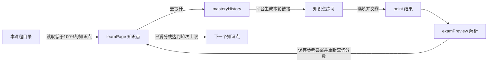

# 智慧树掌握度助手：油猴版

安装文件为根目录的 [`zhihuishu-mastery.user.js`](../zhihuishu-mastery.user.js)。脚本直接运行在已登录的智慧树页面，不依赖 Python 服务。支持 AI 智慧课程页面，以及 `studentexamcomh5.zhihuishu.com` 的知识点练习页面；共享课等其他界面不在当前适配范围内。

## 安装和使用

1. 在浏览器中启用 Tampermonkey，新建脚本，将 `zhihuishu-mastery.user.js` 的全部内容粘贴进去并保存。若安装过旧版掌握度脚本，先停用旧脚本，避免重复点击。
2. 打开已登录的 AI 智慧课程，刷新页面。右下角出现“掌握度助手”面板。
3. 展开“API 与重试设置”，填写自己的 **DeepSeek API Key**。模型默认 `deepseek-flash`，可以修改；每个知识点最多开卷 **10 轮，包含首轮**，可配置 1–10。点击“保存设置”。
4. 点击“开始本课程”。可以从课程目录或知识点页启动，脚本会自动回到本课程目录建立队列。

Key 只存入脚本管理器的本地存储，面板不会回显已保存的 Key。请求发往 DeepSeek 官方接口，内容包括当前文字题干、选项和本题已判错的答案；当前版本没有自定义中转站配置。模型与参数依据 [DeepSeek 模型文档](https://api-docs.deepseek.com/quick_start/pricing/) 和 [思考模式文档](https://api-docs.deepseek.com/guides/thinking_mode/) 设置，使用非思考模式获取结构化答案。真实 API 调用尚未验证。

面板提供暂停、继续、结束、返回课程目录、清除 Key、收起和未达标记录。暂停保留课程队列与轮次；结束后重新开始会重新扫描并建立新任务。一次只运行一门课程，浏览器页面需要保持打开。

## 掌握度策略

- 从当前课程目录的官方响应读取知识点 ID、名称、掌握度，跳过已经 100% 的点。优先处理距离满分较近的点。
- 按平台原有“去提升”入口进入历史页、打开本轮试卷；任务中常规 `window.open` 产生的匹配练习链接在当前标签页打开，避免每轮堆积标签页。
- 优先用本机积累的官方解析答案，没有可用答案时询问 AI。选择题按选项内容匹配，避免选项乱序导致字母错位；填空按空位逐个写入，保留代码中的标点，并检查页面值和保存响应。
- 全卷完成且题数一致后，点击平台交卷按钮及可识别的确认框；进入解析页收集官方答案和判分，再回到知识点页重新读取最高掌握度。
- **以平台确认 100% 为完成条件。** 连续全对次数只做记录；不会把“三次全对”或“80% 计满总评”等同于该知识点已经 100%。这样也能适应教师设置需要其他次数的情况。
- 同一知识点开卷达到配置上限，仍不到 100%，记录名称、实际分数、轮数及原因后，继续下一个知识点。课程结束时明确区分全部满分与仍有未达标项。
- 已判错的本次答案会写入错题记录，后续 AI 请求附带该记录，官方解析中相同的已失败答案不会直接复用。模型仍可能再次给错，轮次上限负责止损。

验证码、API 错误、题数不一致、不能确认保存或未知界面会暂停。无可用题库的图片题暂不发送给文字模型。脚本不能保证所有课程均能达到 100%，也不能修复平台判分异常。

## 页面元素与数据流



| 信息 / 操作 | 当前适配来源 |
| --- | --- |
| 当前课程、班级、知识点 | URL 的动态 ID，保留为字符串，避免大整数精度损失 |
| 本课程知识点及掌握度 | `list-knowledge-theme` 的 `courseThemeList → subThemeList → knowledgeList` |
| 最高掌握度、试卷题数 | `/stu/exam/questions-paper` 的 `highMasteryScore`、`questionNum` |
| 两级“去提升” | `.simplified-mastery__action`、`.improve-btn` |
| 当前题目与整卷题数 | `getExamQuestionInfo`、`getExamSheetInfo` |
| 题干、单选、多选、填空 | `.questionContent` 内的题干、radio/checkbox、input/textarea/contenteditable |
| 填写、选项保存、下一题 | 原生 DOM 点击和 input/change 事件；观察 `saveAnswer` 响应；`.next-topic.next-t` |
| 交卷 | `.reviewDone` 与唯一可识别的确认弹窗 |
| 官方解析与判分 | `questions-paper-result-page` 的 `aiExamQuestionInfo`、`optionDtos`、`result`、`userAnswerDtos` |

脚本在 `document-start` 监听页面自己发出的 XHR/fetch 响应，保留原请求行为。它不直接构造平台签名或写入掌握度；答案通过页面控件填写，由平台正常保存与判分。安装后刷新页面，让监听器能捕获首次响应。

代码入口依次为 `route` → `installObservers` → `startTask/driveTask` → `fillKnownSequence/fillOne` → `officialResult`。队列、轮次、题库和 API 设置使用 `GM_getValue/GM_setValue` 存储。调度状态区分目录、知识点、历史、答题、交卷、解析和分数核验，并用任务 ID 与页面持有者避免同时提交同一任务。

## 参考项目的取舍

- [Cetirzine/zhihuishu-auto-mastery](https://github.com/Cetirzine/zhihuishu-auto-mastery)：Python 项目；本油猴版沿用其页面响应字段、两级入口与解析回收方式，将课程调度放进浏览器脚本。
- [Cooanyh/zhihuishu-zhangwodu](https://github.com/Cooanyh/zhihuishu-zhangwodu)：README 主要适配 `studywisdomh5` 掌握页面，并采用人工确认提交；不能把该页面的卡片颜色和选择器直接套在本次 `ai-smart-course` 页面。
- [lovevacation/zhi-hui-shui-script](https://github.com/lovevacation/zhi-hui-shui-script)：README 包含同一 AI 课程域名、填空与 AI/题库组合，但其目标是 90%+；本版改为逐点读取平台 100%，并设置明确轮次预算。
- [top-tree/zhihuishu](https://github.com/top-tree/zhihuishu)：README 的解析答案沉淀思路适合重复练习；本版用知识点与题目 ID 存储，选择题精确对应选项，填空不做相似题匹配。

后三项是对所给项目 README 的对照，不代表已经验证它们在当前账号的运行效果。

## 本地开发与验证

浏览器运行只需要 Tampermonkey。编辑脚本后在油猴编辑器更新并刷新智慧树页面。开发检查可在项目根目录运行：

```powershell
node --check zhihuishu-mastery.user.js
.\.venv\Scripts\python.exe tests/check_course_flow.py
```

离线集成验证使用 Playwright 与 Edge，所有平台与 AI 响应均由测试夹具模拟，不登录账号、不使用真实 API Key、不提交真实练习。已验证：API 设置保存、跳过已有满分点、填空连续失败 10 轮后的跳转、另一个点三轮后达到 100%、乱序选项、解析题库复用、自动交卷、结果记录及单标签页接续。夹具用同站点导航中的 `window.name` 模拟同步 GM 存储，不使用网络请求模拟本地存储；生产脚本仍使用油猴 GM API。真实脚本管理器的多标签页同步与隔离、真实账号、实际课程 DOM 和真实模型效果尚未验证。
