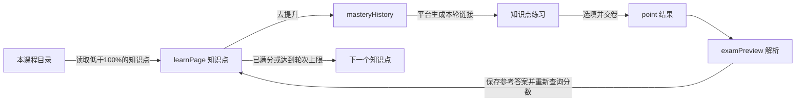

# 智慧树掌握度助手：油猴版

## 2.5.2 掌握度直达与简化设置

调度从目录直接打开 `/masteryHistory/:courseId/:classId/:nodeUid`，nodeName 使用平台原生的 JSON → URI → Base64 编码。旧任务若停在 learnPage，先只读跳离资源页，再执行掌握度核验与原生 `.improve-btn` 入口。不调用资源播放或学习记录接口。判分后回到历史页，等待 `/mastery-statistics/get-node-master-max` 的 `data.masteryMax`；不把全对次数替代为满分。

真实诊断暴露旧账号闸门仅支持 UUID 注入夹具的缺口。新版本扩展只读资料核验及明确用户封装，账号仍必须在作答前确认，换号清除原记忆。`check_mastery_entry.py` 不注入 Vue UUID，覆盖旧版卡住复现、过期任务恢复、目录直达、userId 绑定、换号、无身份时禁止写答案。这些属于隔离测试，未声明新构建已经通过真实账号验证。

普通面板移除 Token、temperature、thinking 控件；自定义接口省略厂商字段，只有明确的不支持长度字段错误才自动替换一次，并缓存成功的地址/模型协议。Key 仍按地址隔离。本机日志开关移至诊断区，独立保存。

## 2.5.0 当前知识点临时记忆与有界日志

当前实现以[数据与日志设计](data-and-logs.md)为准：停止读取旧长期题库，使用单个当前知识点临时会话，逐次提交封存答案并按请求上下文关联判分。身份来自平台原生 UUID 状态或用户信息响应，摘要绑定任务，不读取登录凭据。默认日志只记录运行信息，待发送队列、轮转文件和结构快照均有限额。

以下 2.4.x 与更早小节保留实现演进背景，其中旧题库、旧日志容量描述不适用于 2.5.0。

## 2.4.0 自定义兼容接口

配置项新增 provider、baseUrl、tokenParameter、sendTemperature 与 disableThinking。默认保留既有 DeepSeek 地址、Key、模型与参数；自定义接口默认仅发送 model/messages/max_tokens，可按模型要求改用 max_completion_tokens，并显式开启 temperature 或 DeepSeek 扩展字段。地址统一解析为 Chat Completions 路径，展示规范化后的实际 URL，拒绝 URL 中的凭证、查询参数和片段。HTTPS 与本机 HTTP 可用；不适配原生 Responses/Messages 协议。

`mastery-ai-profiles` 在脚本私有存储中按规范化的完整 endpoint 分别保存 Key、模型及兼容参数，当前配置保存在原 `mastery-ai`。保存新地址且 Key 输入为空时，仅能读取同一地址已有的 Key，不能继承其他服务商的活动 Key。切回已有地址恢复该地址配置；清除 Key 同步清除此地址的缓存，避免切换后恢复已删除凭证。诊断导出不包含配置档案或 Key。

原生与油猴请求均只发往同一选定 endpoint，禁止重定向；保留 CORS/网络失败和 401 的一次通道回退。支持任意自选域名所需的 @connect *，注入页面范围不变。检查请求期间配置身份，旧接口返回不能覆盖新配置的检测结果或继续写入旧模型答案。

新增隔离自动化检查覆盖地址拼接、带斜杠和冒号的模型 ID、官方/中转站切换、跨地址 Key 隔离、通用和厂商参数、同域请求回退、清除 Key 与脱敏导出；另用模拟中转站完成单选及双空代码填写的保存/交卷回归。未使用用户中转账号或追加真实课程验收。

## 2.3.5 自动恢复、未达标接续与暂停弹窗

旧版任何答题失败均暂停整门课。现在将选项状态核对失败标记为可恢复错误：当前试卷等待 1 秒后自动重试，最多恢复两次，不重新开卷、不重置已答进度与轮次。三次均无法操作则记录知识点实际分数与具体原因，保留未达标结果并进入下一点。不会把跳过当作 100%。鉴权、保存拒绝/不明、交卷不明和题目身份变化继续暂停，防止在无法确认时盲写或重复提交。

暂停状态有唯一事件标识，顶层页面显示原生 dialog 模态提示及遮罩，包含点名称、实际掌握度、当前轮次、队列进度、原始原因和处理建议。焦点进入弹窗；原生模态限制背景操作；Escape 与“稍后处理”统一关闭且保持暂停。关闭记录跨页保留，避免每 400ms 或刷新反复弹出；“暂停原因”可重开，新事件会重新提示。“继续自动处理”接续原任务，等待旧异步操作停止后才可用；设置/日志按钮关闭提示并展开相应区域。

同时修复旧自动模式配置缺少 target 时可能在暂停后错误创建新任务的竞争：真实暂停任务优先。仅对同一原试卷、当前知识点相符的旧版选项错误暂停提供一次自动迁移恢复，手动或其他故障暂停不自动清除。

模拟浏览器已验证一次故障后自动恢复、永久失效三次后不交卷且继续下一点、保留实际未达标分数、旧选项暂停自动接续，以及弹窗的焦点、Escape、关闭后刷新不重弹、重开、设置/日志、继续、再次暂停与窄屏布局。弹窗截图为隔离测试页示例，当前账号上的新构建效果仍需更新后确认。

## 2.3.4 动态选项状态核对

用户反馈已处理第一个点，在“散列映射”第二轮停于选项状态不一致。当前实时通道未连接，尚无该轮完整诊断包；不据此断定具体是哪种现场更新。但已在旧版复现相同报错：点击后选项节点重建并回填旧值，旧代码继续检查早先缓存的节点，固定 180ms 也不能覆盖延迟更新。

现在每次动作都重新读取可核对的当前题与选项；题号、题干、选项身份仍需一致，DOM 顺序变化按内容映射。优先读取原生 input.checked，其次 aria，最后自定义图标/CSS，避免旧 is-checked 样式盖过真实未选值。点击原生输入控件或原平台选项行，等待该状态变化后再操作下一项；整组匹配后还需稳定 350ms。允许有限次修正一次性回填，累计最多 10 秒、动作数受选项数限制；始终不更新的控件只点击一次即失败，避免盲目连点。

失败日志包含题号、预期/实际选项索引、节点连接状态、原生类型、CSS、动作次数及原因，并采集脱敏快照。新增回归先在旧版复现，再验证节点重建回填、500ms 延迟更新、陈旧 CSS 均可正确保存并一次提交；真实不响应则保留暂停，零保存、零交卷。实际平台当前这轮仍需更新后核验。

## 2.3.3 选填后保存与自动交卷

用户实际反馈 2.3.2 已成功选题，随后因等待保存回执而暂停。进一步核对当前站点练习页两个公开模块 `chunk-3ed8b2ee.32904706.js` 与 `chunk-3fcca5dd.3b2316d9.js`：选项组件发出 chooseAnswer，父组件只更新 userAnswer；原生 next/submit 才调用 saveAnswer。因此旧模拟夹具“每次点击立即发送保存”的假设不完整。

当前实现优先等待已有自动保存。若未发生，通过页面 realm 中 DOM 的 __vue__ 与父组件寻找唯一原生保存组件，核对课程、班级、知识点、试卷、当前题号及 Vue userAnswer 与刚选填的结果一致，再调用 `saveAnswer(undefined, 'backflag')`。该参数是当前平台已有的保存后返回分支：强制用当前题号保存，不跳转、不提交。保留页面自己的签名/API 处理，不构造平台鉴权。

观察器在请求发出时关联题号和递增序号，要求该题最新请求收到成功业务码与 data:true；旧请求或其他题的回执不能代替。拒绝保存、数据为空、绑定不一致或找不到相符组件时暂停。填空增加组件原有的 keyup 触发点，随后核对实际绑定及保存。题目数据另存副本，避免页面编辑填空时修改观察对象，误判为换题。

确认保存后，沿用原生提交入口。当前 point=1 页面可直接由平台保存/核对答题数后提交，无需假设一定出现确认框；若出现，支持“提交试卷”等实际按钮文字。新增测试覆盖仅更新 Vue 的多选（含已经选中后的续答）、保存拒绝、错误答案绑定、错误试卷组件、单选接双空填空、一次交卷、解析和分数核验。真实平台此次保存/交卷尚需更新后验证。

## 2.3.2 请求通道修复

同一用户 Key 的本机官方调用、附带扩展来源信息的调用、隔离 Edge 中从练习页来源发出的原生浏览器请求均为 200。官方接口的 CORS 预检也允许该来源及 Authorization/Content-Type。检查本机 Tampermonkey 5.5.1 的公开安装代码，未发现显式鉴权头被主动删除。因此不将旧实例的 401 武断归因为 Key 无效或某个确定的扩展缺陷；实际保存配置和旧扩展请求的差异仍缺少现场证据。

脚本在课程应用改写请求函数之前保存浏览器 fetch，优先使用已验证的原生路径，`credentials: omit`、`referrerPolicy: no-referrer`、`redirect: error`。只有网络/CORS 失败或明确 401 才尝试一次油猴后台通道；其余错误不增加调用。两条路径均仅使用官方 HTTPS 地址。成功通道在本页内复用；独立超时和一次结算避免油猴 fetch 模式 timeout 不生效时永久卡住。

每次请求计算本机 Key 的 SHA-256 前 12 位作为配置标识，记录通道、模型、状态及耗时，不记录 Key、题目正文、请求头或错误响应原文。测试成功后更新旧的 API 暂停提示；当前试卷和轮次保留。模拟检查覆盖原生成功、原生 401/网络失败后油猴成功、两条通道均 401、402 不重试、无效回答不重试，以及原多选/填空/暂停续答路径。

修复后的完整脚本已在隔离 Edge 测试页使用用户提供的同一 Key 点击面板连接检测：真实官方返回成功，通道为 browser，没有浏览器脚本异常。此证据覆盖实际源码的配置读取、鉴权头、真实模型请求及返回解析；不替代已登录油猴实例中的课程保存、交卷和判分验收。

## 2.3.1 真实 AI 鉴权失败与重复读取修复

后续直接检测补充：同一用户提供的 Key，在本机直接请求官方 `/models` 与 `/chat/completions`（`deepseek-flash`、关闭思考模式）均返回 HTTP 200，模型正常返回内容。因此不能将浏览器中的 401 直接归因于该 Key 无效；尚需核对脚本实际保存的配置及浏览器扩展请求。检测仅向官方接口发送，未将 Key 写入项目或日志；该检测不等于油猴请求或课程答题已经通过。

用户提供的真实 2.3.0 日志已证实：读取 134 个知识点、建立 62 点未满队列，进入目标知识点历史与练习，捕获一道四选项多选题并发出官方 AI 请求，随后 HTTP 401 而暂停。这是当前“能跳转但一题未做”的直接原因；未发生答案写入、保存或交卷，不能称作答题已通过。该报告的本机日志设置为关闭，实际新版运行事实由导出的启动记录与构建标识确认。

官方文档确认 `deepseek-flash` 对应 DeepSeek-V4.1-Flash-1017，401 表示 Key 鉴权失败。新增同接口、同模型的连接测试与明确错误说明，清理粘贴的 Bearer/外层引号；用户仍需在本机提供有效官方 Key，代码不代取或绕过凭证。请求不记录 Key、Authorization 或原始错误响应。连接测试不包含题目，仅请求极短回答。

真实日志还显示 AI 等待期间同一题被重复读取。现在以题号、题型、题干、选项及附件组成题目身份；答案回写不改变题目身份。异步答案前后继续检查页面、任务、题干和选项，真正换题仍会暂停。模拟测试覆盖 401→本机更换 Key→连接检测→原试卷继续、多选保存与一次交卷，并检查重试计数保留、同题重复可继续及真实换题禁止旧回答。

## 2.3.0 自动模式与执行端核对

自动模式单独保存在 `mastery-auto`：等待进入课程、运行、暂停、课程结束。进入新课程时建立该课任务，保留旧暂停任务的归档；暂停或结束后刷新不隐式重开。手动从知识点页启动时优先处理当前点，再接其余未满分点。普通队列仍按掌握度降序。

构建编号由 `python tools/stamp_build.py` 按源码内容生成；面板、`runtime.boot` 和可选本机握手报告相同编号。`GM_info` 仅记录脚本管理器名称/版本及其认定的脚本版本，帮助识别源文件已更新但实际执行端未更新的情况。

本机调试默认关闭。开启后每个页面生成独立随机客户端凭证，限定接口只处理状态上报、扫描、采集、启动、暂停和继续；控制端还需读取本机生成的独立凭证。指令必须匹配在线文档、课程和班级，有效期 15 秒，只派送一次。没有任意 JS、选择器、模型密钥读取或外部 URL 指令。调试可在处理若干点后暂停并保留余下队列，继续时不重置轮次。

已补课程总览自动开启后进入课程、限定单点暂停、刷新保留暂停、继续余下队列的模拟检查。真实浏览器运行仍须以同构建握手、真实保存回执和官方掌握度为证据，不能由这些检查推断通过。

## 2.2.0 真实卡片与参考源码核对

新增以真实 DOM 卡片为依据的目录路径：`.item-content[id^="knowledgeId-"]` 提供精确知识点编号，`.item-title` 提供名称，`.item-top-right-svg` 与 `.item-top-right-text` 共同确认掌握度。读取所有已渲染卡片，包括屏幕外的条目；无掌握度仪表的本版卡片不纳入自动答题。接口字段异常时由相同编号的卡片恢复，无法确认的条目明确保留为异常，不能把课程标成全部完成。

队列优先通过对应卡片标题触发平台原跳转；未发生跳转时再使用已验证的 learnPage 路由。另一门课的暂停任务可在明确启动当前课时归档，避免旧任务阻挡当前课。暂停中的同轮已确认答题进度会保留；整卷题数一致即完成作答，不要求末题“下一题”控件消失。异步 AI 返回后会再次核对任务 ID 与所有者，防止暂停或换课后继续填写。

本次实际阅读了以下参考源码，详情和差异见下方；参考代码仅保存在本地排除目录中，没有作为第三方源码打包。

## 2.1.1 真实日志定向修复

收到的真实日志表明课程列表与目录已经捕获，任务停在目录字段校验。站点公开的知识点卡片代码将空掌握度显示为“免考”；旧版一律抛错会导致整门课被免考条目阻断。现在显式 null 跳过，缺失与非法字段仍拒绝；每个拒绝条目记录具体原因，全免考课程不标记为 100%。

XHR 文本与 fetch 响应副本使用无损整数解析，避免大 ID 在 JSON.parse 中先被舍入。未修改网页自己的响应或请求。任务报错后延迟补采当前页面；监听函数引用变化降为诊断警告，结合仍在到达的响应判断，不能仅凭引用变化就认定监听完全失效。

## 2.1.0 本地诊断改动

补齐可拖动并记忆位置的面板、始终可见的未知页面诊断入口、哈希路由识别和 iframe 请求观察。课程总览通过实际课程链接或已观察到的课程列表响应发现入口；`masteryAnalysis` 等课程子页启动时进入该课程的知识点目录。未适配的题型或页面只报告等待原因，不宣称已经自动完成。

2026-11-05 对照站点公开构建核对到：`/myCourses` 使用 `/stu/center/course-list`，数据包含 `completeCourseList` 与 `studyCourseList`；掌握度统计使用 `/singleCourse/masteryAnalysis/:courseId/:classId`。已补入监听与入口识别。依据为站点的 [入口构建](https://ai-smart-course-student-pro.zhihuishu.com/assets/index-C_8TpBKc.js) 与 [课程列表模块](https://ai-smart-course-student-pro.zhihuishu.com/assets/index-Bt2SUynh.js)，构建文件名可能随站点更新而变化。这些静态代码证据不能替代真实账号 DOM 验证。

运行日志覆盖启动、路由、页面点击、接口状态与字段结构、任务阶段、明确等待原因、题目读取、AI 状态与异常；最近 8 页、每页最多 300 条。面板提供级别筛选、元素采集与 JSON 导出。可运行 `python tools/debug_collector.py`，日志写入 `.local/runtime.jsonl`，元素快照写入 `.local/snapshots/`。跳转后补传未确认的日志；服务端去重与二次脱敏；失败写盘不计作已送达。具体安装和调试步骤见根目录 README。

安装文件为根目录的 [`zhihuishu-mastery.user.js`](../zhihuishu-mastery.user.js)。脚本直接运行在已登录的智慧树页面，不依赖 Python 服务。支持 AI 智慧课程页面，以及 `studentexamcomh5.zhihuishu.com` 的知识点练习页面；共享课等其他界面不在当前适配范围内。

## 安装和使用

1. 在浏览器中启用 Tampermonkey，新建脚本，将 `zhihuishu-mastery.user.js` 的全部内容粘贴进去并保存。若安装过旧版掌握度脚本，先停用旧脚本，避免重复点击。
2. 打开已登录的 AI 智慧课程，刷新页面。右下角出现“掌握度助手”面板。
3. 展开“API 与重试设置”，选择官方或自定义接口，填写该接口对应的 API Key 与模型。DeepSeek 官方默认 `deepseek-flash`；自定义接口按服务商要求填写。每个知识点最多开卷 **10 轮，包含首轮**，可配置 1–10。点击“保存设置”。
4. 点击“开始本课程”。可以从课程目录或知识点页启动，脚本会自动回到本课程目录建立队列。

Key 只存入脚本管理器的本地存储，面板不会回显已保存的 Key。请求仅发往用户选择的接口，内容包括当前文字题干、选项和本题已判错的答案。DeepSeek 默认参数保留非思考模式；自定义兼容接口默认不附带厂商专用参数。配置示例见根目录 README。

面板提供暂停、继续、结束、返回课程目录、清除 Key、收起和未达标记录。暂停保留课程队列与轮次；结束后重新开始会重新扫描并建立新任务。一次只运行一门课程，浏览器页面需要保持打开。

## 掌握度策略

- 从当前课程目录的官方响应读取知识点 ID、名称、掌握度，跳过已经 100% 的点。优先处理距离满分较近的点。
- 按平台原有“去提升”入口进入历史页、打开本轮试卷；任务中常规 `window.open` 产生的匹配练习链接在当前标签页打开，避免每轮堆积标签页。
- 优先用本机积累的官方解析答案，没有可用答案时询问 AI。选择题按选项内容匹配，避免选项乱序导致字母错位；填空按空位逐个写入，保留代码中的标点，并检查页面值和保存响应。
- 全卷完成且题数一致后，点击平台交卷按钮及可识别的确认框；进入解析页收集官方答案和判分，再回到知识点页重新读取最高掌握度。
- **以平台确认 100% 为完成条件。** 连续全对次数只做记录；不会把“三次全对”或“80% 计满总评”等同于该知识点已经 100%。这样也能适应教师设置需要其他次数的情况。
- 同一知识点开卷达到配置上限，仍不到 100%，记录名称、实际分数、轮数及原因后，继续下一个知识点。课程结束时明确区分全部满分与仍有未达标项。
- 已判错的本次答案会写入错题记录，后续 AI 请求附带该记录，官方解析中相同的已失败答案不会直接复用。模型仍可能再次给错，轮次上限负责止损。

验证码、API 错误、题数不一致、不能确认保存或未知界面会暂停。无可用题库的图片题暂不发送给文字模型。脚本不能保证所有课程均能达到 100%，也不能修复平台判分异常。

## 页面元素与数据流



| 信息 / 操作 | 当前适配来源 |
| --- | --- |
| 当前课程、班级、知识点 | URL 的动态 ID，保留为字符串，避免大整数精度损失 |
| 本课程知识点及掌握度 | `list-knowledge-theme` 的 `courseThemeList → subThemeList → knowledgeList` |
| 最高掌握度、试卷题数 | `/stu/exam/questions-paper` 的 `highMasteryScore`、`questionNum` |
| 两级“去提升” | `.simplified-mastery__action`、`.improve-btn` |
| 当前题目与整卷题数 | `getExamQuestionInfo`、`getExamSheetInfo` |
| 题干、单选、多选、填空 | `.questionContent` 内的题干、radio/checkbox、input/textarea/contenteditable |
| 填写、选项保存、下一题 | 原生 DOM 点击和 input/change 事件；观察 `saveAnswer` 响应；`.next-topic.next-t` |
| 交卷 | `.reviewDone` 与唯一可识别的确认弹窗 |
| 官方解析与判分 | `questions-paper-result-page` 的 `aiExamQuestionInfo`、`optionDtos`、`result`、`userAnswerDtos` |

脚本在 `document-start` 监听页面自己发出的 XHR/fetch 响应，保留原请求行为。它不直接构造平台签名或写入掌握度；答案通过页面控件填写，由平台正常保存与判分。安装后刷新页面，让监听器能捕获首次响应。

代码入口依次为 `route` → `installObservers` → `startTask/driveTask` → `fillKnownSequence/fillOne` → `officialResult`。队列、轮次、当前知识点临时记忆和 API 设置使用 `GM_getValue/GM_setValue` 存储。调度状态区分目录、知识点、历史、答题、交卷、解析和分数核验，并用任务 ID 与页面持有者避免同时提交同一任务。

## 参考项目的取舍

- [Cetirzine/zhihuishu-auto-mastery](https://github.com/Cetirzine/zhihuishu-auto-mastery)：Python 项目；本油猴版沿用其页面响应字段、两级入口与解析回收方式，将课程调度放进浏览器脚本。
- [Cooanyh/zhihuishu-zhangwodu](https://github.com/Cooanyh/zhihuishu-zhangwodu)：已读 `b82b1b9` 的 `zhihuishu-zhangwodu.user.js`。其 `.item-box`、`.mastery-box-custom-popover`、`.exam-item .question-item` 属于 `studywisdomh5` 界面，和本次页面不同。参考其弹层对应校验；当前自动答题仍采用本次 AI 课程适配器。
- [lovevacation/zhi-hui-shui-script](https://github.com/lovevacation/zhi-hui-shui-script)：已读 `d55836e` 的 `index.js`，核对 `processLearnPage`、`processMasteryHistoryPage` 和答题函数。实际选择器包括 `.section-item-collapse-info .title-text`、`.simplified-mastery__action`、`.improve-btn`、`.questionContent`、`.el-input__inner` 与 `.checkIcon`。其学习页按 90% 跳过的条件不适用于本任务；本版维持平台 100% 核验。填空采用按空位的字符串数组，保留代码标点。
- [top-tree/zhihuishu](https://github.com/top-tree/zhihuishu)：已读 `6e6d62e` 的 `main.user.js`，核对 `SELECTORS`、`findAndScrollToIncompleteItem`、`handleLearnPage`、`processMasteryHistory` 及选填/交卷实现。参考了逐卡扫描、标题点击、题目选中态检查及解析采集。其进度选择器不能直接替代当前页面的掌握度仪表，因此以真实导出 DOM 中的 `.item-top-right` 为准。

上述为代码和真实 DOM 结构对照，不代表这些第三方脚本已在当前账号完成运行验收。回放测试不访问账号、不调用真实模型、不提交真实练习。

## 本地开发与验证

浏览器运行只需要 Tampermonkey。编辑脚本后在油猴编辑器更新并刷新智慧树页面。开发检查可在项目根目录运行：

```powershell
node --check zhihuishu-mastery.user.js
.\.venv\Scripts\python.exe tests/check_course_flow.py
```

离线集成验证使用 Playwright 与 Edge，所有平台与 AI 响应均由测试夹具模拟，不登录账号、不使用真实 API Key、不提交真实练习。已验证：API 设置保存、跳过已有满分点、填空连续失败 10 轮后的跳转、另一个点三轮后达到 100%、乱序选项、解析题库复用、自动交卷、结果记录及单标签页接续。夹具用同站点导航中的 `window.name` 模拟同步 GM 存储，不使用网络请求模拟本地存储；生产脚本仍使用油猴 GM API。真实脚本管理器的多标签页同步与隔离、真实账号、实际课程 DOM 和真实模型效果尚未验证。
